# NetPresence network simulator: results (full)

Code fingerprint `6df421e722eb9d6f`. Every number below is regenerated by `python -m paper.make`; nothing is typed by hand.

**Provenance.** Radio, human-timing and baseline parameters are assumptions until measured (SIM_PLAN section 5). Assumed configuration fields: A, aisle, bench_pitch_y, body_cap, body_db, body_max_m, body_radius, capture, capture_db, d_corr, dir_sigma, door_width, fast_sigma, ios_min_report_ms, ios_scan_dwell_ms, ios_share, model_mix, models, n, n_outside, orient_db, orient_mix, p_bg, p_detect, pitch_x, pitch_y, rician_k_db, seat_pitch, shadow_model, shadow_sigma, startup_s, t_ifs_adv_ms, tap_median_s, tap_sigma, uplink, wall_db. E12 and E13 say explicitly whether real or synthetic data was used.

## E01 Accuracy at classroom scale

*How accurate is the roll call from 20 to 93 students, door open and closed?*

| students | door | false-absent | corridor admitted | classrooms |
|---|---|---|---|---|
| 20 | open | 5.05% [3.23, 7.55] | 5.50% [2.12, 9.62] | 100 |
| 20 | closed | 4.94% [3.17, 7.41] | 0.00% [0.00, 0.00] | 100 |
| 35 | open | 1.16% [0.79, 1.56] | 8.25% [4.00, 13.12] | 100 |
| 35 | closed | 1.10% [0.73, 1.50] | 1.38% [0.00, 3.75] | 100 |
| 50 | open | 2.01% [0.74, 4.21] | 3.00% [0.75, 5.75] | 100 |
| 50 | closed | 2.01% [0.74, 4.21] | 0.00% [0.00, 0.00] | 100 |
| 60 | open | 0.59% [0.40, 0.82] | 3.38% [1.25, 6.38] | 100 |
| 60 | closed | 0.59% [0.40, 0.82] | 0.00% [0.00, 0.00] | 100 |
| 75 | open | 0.50% [0.33, 0.67] | 0.50% [0.00, 1.12] | 100 |
| 75 | closed | 0.50% [0.33, 0.67] | 0.00% [0.00, 0.00] | 100 |
| 93 | open | 0.37% [0.24, 0.52] | 1.75% [0.00, 4.50] | 100 |
| 93 | closed | 0.37% [0.24, 0.52] | 0.00% [0.00, 0.00] | 100 |

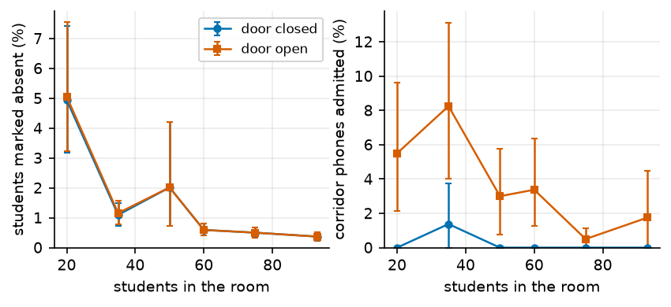

## E02 What each mechanism buys

*What does each design element contribute to accuracy and security?*

| students | variant | false-absent | corridor admitted | relay admitted | vs full (FAR) |
|---|---|---|---|---|---|
| 93 | full system | 0.39% [0.22, 0.60] | 0.42% [0.00, 1.25] | 2.22% [0.56, 4.44] | - |
| 93 | no disjoint paths | 0.39% [0.22, 0.60] | 5.21% [1.67, 9.79] | 2.22% [0.56, 4.44] | +0.00 pp |
| 93 | no self-calibration | 31.13% [26.06, 36.35] | 0.00% [0.00, 0.00] | 2.22% [0.56, 4.44] | +30.74 pp * |
| 93 | no adaptive edge | 0.39% [0.22, 0.60] | 0.42% [0.00, 1.25] | 2.22% [0.56, 4.44] | +0.00 pp |
| 93 | no discovery tail | 0.56% [0.36, 0.79] | 0.42% [0.00, 1.25] | 3.33% [1.11, 6.11] | +0.17 pp * |
| 93 | k = 1 | 0.39% [0.22, 0.60] | 9.38% [4.17, 15.62] | 2.22% [0.56, 4.44] | +0.00 pp |
| 93 | k = 3 | 0.52% [0.32, 0.77] | 0.00% [0.00, 0.00] | 2.22% [0.56, 4.44] | +0.13 pp * |
| 93 | no co-location check | 0.39% [0.22, 0.60] | 0.42% [0.00, 1.25] | 100.00% [100.00, 100.00] | +0.00 pp |
| 35 | full system | 0.91% [0.46, 1.36] | 6.88% [1.88, 12.92] | 3.33% [1.11, 6.11] | - |
| 35 | no disjoint paths | 0.86% [0.41, 1.32] | 39.38% [27.92, 51.25] | 3.33% [1.11, 6.11] | -0.05 pp |
| 35 | no self-calibration | 61.50% [54.47, 68.09] | 0.00% [0.00, 0.00] | 1.67% [0.00, 3.33] | +60.59 pp * |
| 35 | no adaptive edge | 28.62% [20.46, 37.56] | 0.00% [0.00, 0.00] | 1.67% [0.00, 3.89] | +27.71 pp * |
| 35 | no discovery tail | 2.94% [0.86, 6.60] | 6.46% [1.67, 12.50] | 5.00% [2.22, 8.89] | +2.03 pp * |
| 35 | k = 1 | 0.41% [0.15, 0.71] | 42.92% [31.04, 55.62] | 3.33% [1.11, 6.11] | -0.51 pp * |
| 35 | k = 3 | 4.56% [2.34, 8.44] | 0.21% [0.00, 0.62] | 3.33% [1.11, 6.11] | +3.65 pp * |
| 35 | no co-location check | 0.81% [0.41, 1.22] | 6.88% [1.88, 12.92] | 98.89% [97.22, 100.00] | -0.10 pp |

`*` = paired 95% CI excludes 0.

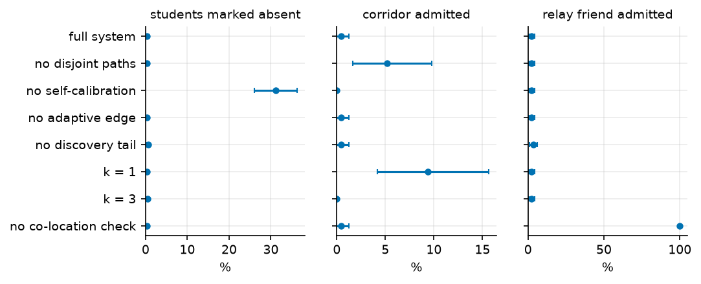

## E03 Attacks and the co-location defence

*Which attacks work, and how well does the co-location check stop relays?*

| attack | setting | outcome |
|---|---|---|
| A3 collusion | k=1, accomplices=0 | friend admitted 0.00% [0.00, 0.00] |
| A3 collusion | k=1, accomplices=1 | friend admitted 100.00% [100.00, 100.00] |
| A3 collusion | k=1, accomplices=2 | friend admitted 100.00% [100.00, 100.00] |
| A3 collusion | k=1, accomplices=3 | friend admitted 100.00% [100.00, 100.00] |
| A3 collusion | k=1, accomplices=4 | friend admitted 100.00% [100.00, 100.00] |
| A3 collusion | k=2, accomplices=0 | friend admitted 0.00% [0.00, 0.00] |
| A3 collusion | k=2, accomplices=1 | friend admitted 0.00% [0.00, 0.00] |
| A3 collusion | k=2, accomplices=2 | friend admitted 100.00% [100.00, 100.00] |
| A3 collusion | k=2, accomplices=3 | friend admitted 100.00% [100.00, 100.00] |
| A3 collusion | k=2, accomplices=4 | friend admitted 100.00% [100.00, 100.00] |
| A3 collusion | k=3, accomplices=0 | friend admitted 0.00% [0.00, 0.00] |
| A3 collusion | k=3, accomplices=1 | friend admitted 0.00% [0.00, 0.00] |
| A3 collusion | k=3, accomplices=2 | friend admitted 0.00% [0.00, 0.00] |
| A3 collusion | k=3, accomplices=3 | friend admitted 100.00% [100.00, 100.00] |
| A3 collusion | k=3, accomplices=4 | friend admitted 100.00% [100.00, 100.00] |
| A4 relay | without co-location, 1 relays | admitted 100.00% [100.00, 100.00], flagged 0.00% [0.00, 0.00], honest flagged 0.00% [0.00, 0.00] |
| A4 relay | without co-location, 3 relays | admitted 100.00% [100.00, 100.00], flagged 0.00% [0.00, 0.00], honest flagged 0.00% [0.00, 0.00] |
| A4 relay | without co-location, 5 relays | admitted 100.00% [100.00, 100.00], flagged 0.00% [0.00, 0.00], honest flagged 0.00% [0.00, 0.00] |
| A4 relay | with co-location, 1 relays | admitted 1.67% [0.00, 5.00], flagged 98.33% [95.00, 100.00], honest flagged 0.00% [0.00, 0.00] |
| A4 relay | with co-location, 3 relays | admitted 2.22% [0.56, 4.44], flagged 97.78% [95.56, 99.44], honest flagged 0.00% [0.00, 0.00] |
| A4 relay | with co-location, 5 relays | admitted 1.00% [0.00, 2.33], flagged 99.00% [97.67, 100.00], honest flagged 0.00% [0.00, 0.00] |
| A5 inflation | +0 dB | corridor phone admitted 0.00% [0.00, 0.00], false-absent 0.70% [0.44, 1.02] |
| A5 inflation | +5 dB | corridor phone admitted 0.00% [0.00, 0.00], false-absent 0.70% [0.44, 1.02] |
| A5 inflation | +10 dB | corridor phone admitted 0.00% [0.00, 0.00], false-absent 0.70% [0.44, 1.02] |
| A5 inflation | +15 dB | corridor phone admitted 0.00% [0.00, 0.00], false-absent 0.70% [0.44, 1.02] |
| A5 inflation | +20 dB | corridor phone admitted 0.00% [0.00, 0.00], false-absent 0.70% [0.44, 1.02] |
| ROC | colocation_db=0.5 | relays flagged 0.00% [0.00, 0.00], honest flagged 0.00% [0.00, 0.00] |
| ROC | colocation_db=1.0 | relays flagged 1.00% [0.00, 2.33], honest flagged 0.00% [0.00, 0.00] |
| ROC | colocation_db=1.5 | relays flagged 96.67% [94.33, 98.67], honest flagged 0.00% [0.00, 0.00] |
| ROC | colocation_db=2.0 | relays flagged 96.67% [94.33, 98.67], honest flagged 0.00% [0.00, 0.00] |
| ROC | colocation_db=2.5 | relays flagged 99.00% [97.67, 100.00], honest flagged 0.00% [0.00, 0.00] |
| ROC | colocation_db=3.0 | relays flagged 100.00% [100.00, 100.00], honest flagged 0.64% [0.32, 0.99] |
| ROC | colocation_db=3.5 | relays flagged 100.00% [100.00, 100.00], honest flagged 0.64% [0.32, 0.99] |
| ROC | colocation_db=4.0 | relays flagged 100.00% [100.00, 100.00], honest flagged 1.56% [0.99, 2.13] |
| ROC | colocation_db=5.0 | relays flagged 100.00% [100.00, 100.00], honest flagged 18.05% [16.21, 20.03] |
| ROC | colocation_db=6.0 | relays flagged 100.00% [100.00, 100.00], honest flagged 75.75% [73.72, 77.96] |

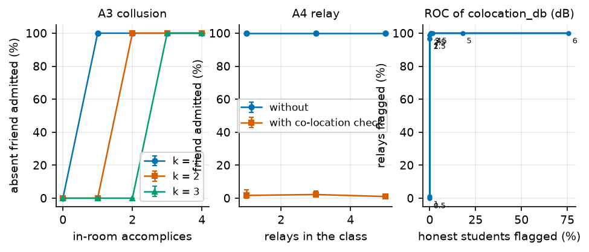

## E04 Android/iOS mix

*Does the system hold up for any mix of phones, and what does self-calibration buy?*

| iOS share | TX asymmetry (dB) | self-cal | false-absent |
|---|---|---|---|
| 0% | 0.0 | on | 0.39% [0.17, 0.65] |
| 0% | 0.0 | off | 0.39% [0.17, 0.65] |
| 0% | 6.0 | on | 0.39% [0.17, 0.65] |
| 0% | 6.0 | off | 0.39% [0.17, 0.65] |
| 0% | 12.0 | on | 0.39% [0.17, 0.65] |
| 0% | 12.0 | off | 0.39% [0.17, 0.65] |
| 0% | 18.0 | on | 0.39% [0.17, 0.65] |
| 0% | 18.0 | off | 0.39% [0.17, 0.65] |
| 25% | 0.0 | on | 0.39% [0.17, 0.65] |
| 25% | 0.0 | off | 0.53% [0.28, 0.84] |
| 25% | 6.0 | on | 0.39% [0.17, 0.65] |
| 25% | 6.0 | off | 23.92% [20.68, 28.70] |
| 25% | 12.0 | on | 0.39% [0.17, 0.65] |
| 25% | 12.0 | off | 23.92% [20.68, 28.70] |
| 25% | 18.0 | on | 0.39% [0.17, 0.65] |
| 25% | 18.0 | off | 23.92% [20.68, 28.70] |
| 50% | 0.0 | on | 0.36% [0.17, 0.59] |
| 50% | 0.0 | off | 0.98% [0.65, 1.35] |
| 50% | 6.0 | on | 0.36% [0.17, 0.59] |
| 50% | 6.0 | off | 29.51% [22.80, 36.92] |
| 50% | 12.0 | on | 0.36% [0.17, 0.59] |
| 50% | 12.0 | off | 29.51% [22.80, 36.92] |
| 50% | 18.0 | on | 0.36% [0.17, 0.59] |
| 50% | 18.0 | off | 29.51% [22.80, 36.92] |
| 75% | 0.0 | on | 0.36% [0.17, 0.59] |
| 75% | 0.0 | off | 2.05% [1.60, 2.55] |
| 75% | 6.0 | on | 0.36% [0.17, 0.59] |
| 75% | 6.0 | off | 24.59% [22.38, 26.75] |
| 75% | 12.0 | on | 0.36% [0.17, 0.59] |
| 75% | 12.0 | off | 24.59% [22.38, 26.75] |
| 75% | 18.0 | on | 0.36% [0.17, 0.59] |
| 75% | 18.0 | off | 24.59% [22.38, 26.75] |
| 100% | 0.0 | on | 0.36% [0.17, 0.59] |
| 100% | 0.0 | off | 0.36% [0.17, 0.59] |
| 100% | 6.0 | on | 0.36% [0.17, 0.59] |
| 100% | 6.0 | off | 0.36% [0.17, 0.59] |
| 100% | 12.0 | on | 0.36% [0.17, 0.59] |
| 100% | 12.0 | off | 0.36% [0.17, 0.59] |
| 100% | 18.0 | on | 0.36% [0.17, 0.59] |
| 100% | 18.0 | off | 0.36% [0.17, 0.59] |

| students | per-model offset table on the server | false-absent (30% iOS) |
|---|---|---|
| 20 | yes | 6.15% [2.36, 11.86] |
| 20 | NO (fresh server) | 42.10% [30.69, 52.65] |
| 35 | yes | 0.69% [0.23, 1.22] |
| 35 | NO (fresh server) | 6.10% [3.14, 10.28] |
| 60 | yes | 0.52% [0.26, 0.78] |
| 60 | NO (fresh server) | 1.35% [0.92, 1.75] |
| 93 | yes | 0.39% [0.17, 0.65] |
| 93 | NO (fresh server) | 0.95% [0.62, 1.32] |

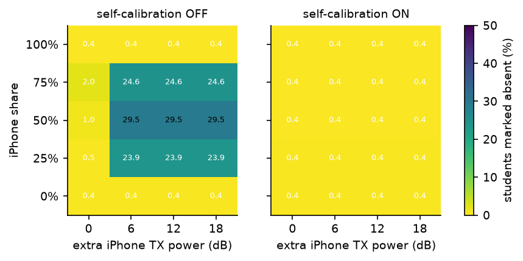

## E05 Speed

*How short can the window be, and how long does a student wait compared with calling names?*

| window (s) | tap median (s) | false-absent | wait p50 / p95 (s) |
|---|---|---|---|
| 10 | 2.0 | 0.36% [0.17, 0.59] | 23 / 24 |
| 10 | 4.0 | 6.12% [5.28, 7.05] | 21 / 24 |
| 10 | 6.0 | 20.24% [18.64, 21.91] | 20 / 23 |
| 10 | 10.0 | 68.81% [62.95, 75.20] | 18 / 22 |
| 15 | 2.0 | 0.03% [0.00, 0.08] | 28 / 29 |
| 15 | 4.0 | 1.32% [0.95, 1.71] | 26 / 29 |
| 15 | 6.0 | 6.12% [5.28, 7.05] | 24 / 28 |
| 15 | 10.0 | 25.77% [24.06, 27.79] | 22 / 27 |
| 20 | 2.0 | 0.00% [0.00, 0.00] | 33 / 34 |
| 20 | 4.0 | 0.36% [0.17, 0.59] | 31 / 34 |
| 20 | 6.0 | 2.02% [1.54, 2.53] | 29 / 33 |
| 20 | 10.0 | 12.86% [11.79, 13.93] | 26 / 31 |
| 30 | 2.0 | 0.00% [0.00, 0.00] | 43 / 44 |
| 30 | 4.0 | 0.03% [0.00, 0.08] | 41 / 44 |
| 30 | 6.0 | 0.36% [0.17, 0.59] | 39 / 43 |
| 30 | 10.0 | 3.17% [2.58, 3.76] | 35 / 41 |
| 45 | 2.0 | 0.00% [0.00, 0.00] | 58 / 59 |
| 45 | 4.0 | 0.00% [0.00, 0.00] | 56 / 59 |
| 45 | 6.0 | 0.03% [0.00, 0.08] | 54 / 58 |
| 45 | 10.0 | 0.59% [0.34, 0.87] | 50 / 56 |
| manual roll call | - | 0% (proxies possible) | 132 / 251 |

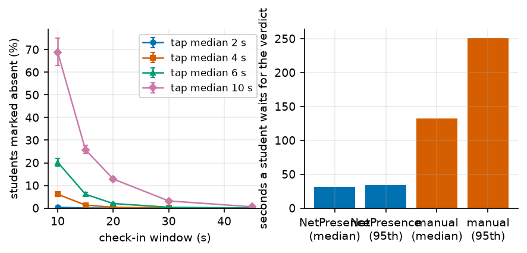

## E06 Uplink

*Is the network ever the bottleneck, and does upload jitter help?*

| profile | jitter (s) | students | false-absent | delivered % | last report (s) | attempts |
|---|---|---|---|---|---|---|
| ideal | 0.0 | 35 | 0.91% [0.31, 1.53] | - | - | - |
| ideal | 0.0 | 93 | 0.49% [0.22, 0.79] | - | - | - |
| ideal | 2.0 | 35 | 0.91% [0.31, 1.53] | - | - | - |
| ideal | 2.0 | 93 | 0.49% [0.22, 0.79] | - | - | - |
| ideal | 5.0 | 35 | 0.91% [0.31, 1.53] | - | - | - |
| ideal | 5.0 | 93 | 0.49% [0.22, 0.79] | - | - | - |
| wifi_good | 0.0 | 35 | 0.91% [0.31, 1.53] | 100.0 | 1.0 | 1.0 |
| wifi_good | 0.0 | 93 | 0.49% [0.22, 0.79] | 100.0 | 1.3 | 1.0 |
| wifi_good | 2.0 | 35 | 0.91% [0.31, 1.53] | 100.0 | 2.7 | 1.0 |
| wifi_good | 2.0 | 93 | 0.49% [0.22, 0.79] | 100.0 | 3.3 | 1.0 |
| wifi_good | 5.0 | 35 | 0.91% [0.31, 1.53] | 100.0 | 5.4 | 1.0 |
| wifi_good | 5.0 | 93 | 0.56% [0.26, 0.90] | 99.9 | 5.6 | 1.0 |
| wifi_congested | 0.0 | 35 | 0.91% [0.31, 1.53] | 100.0 | 4.5 | 1.0 |
| wifi_congested | 0.0 | 93 | 0.49% [0.22, 0.79] | 100.0 | 5.0 | 1.0 |
| wifi_congested | 2.0 | 35 | 0.91% [0.31, 1.53] | 100.0 | 5.0 | 1.0 |
| wifi_congested | 2.0 | 93 | 0.60% [0.30, 0.90] | 99.9 | 6.8 | 1.1 |
| wifi_congested | 5.0 | 35 | 1.42% [0.61, 2.24] | 99.6 | 6.5 | 1.0 |
| wifi_congested | 5.0 | 93 | 1.98% [0.79, 4.08] | 98.6 | 7.6 | 1.0 |
| cell_4g | 0.0 | 35 | 0.91% [0.31, 1.53] | 100.0 | 2.6 | 1.0 |
| cell_4g | 0.0 | 93 | 0.49% [0.22, 0.79] | 100.0 | 3.3 | 1.0 |
| cell_4g | 2.0 | 35 | 0.91% [0.31, 1.53] | 100.0 | 4.1 | 1.0 |
| cell_4g | 2.0 | 93 | 0.49% [0.22, 0.79] | 100.0 | 4.7 | 1.0 |
| cell_4g | 5.0 | 35 | 1.12% [0.51, 1.73] | 99.8 | 6.1 | 1.0 |
| cell_4g | 5.0 | 93 | 0.60% [0.30, 0.94] | 99.9 | 6.6 | 1.0 |
| wifi_congested:0.7,cell_4g:0.3 | 0.0 | 35 | 0.91% [0.31, 1.53] | 100.0 | 4.3 | 1.0 |
| wifi_congested:0.7,cell_4g:0.3 | 0.0 | 93 | 0.49% [0.22, 0.79] | 100.0 | 4.8 | 1.0 |
| wifi_congested:0.7,cell_4g:0.3 | 2.0 | 35 | 0.91% [0.31, 1.53] | 100.0 | 4.9 | 1.0 |
| wifi_congested:0.7,cell_4g:0.3 | 2.0 | 93 | 0.56% [0.30, 0.86] | 99.9 | 6.4 | 1.1 |
| wifi_congested:0.7,cell_4g:0.3 | 5.0 | 35 | 1.02% [0.40, 1.72] | 99.9 | 6.3 | 1.0 |
| wifi_congested:0.7,cell_4g:0.3 | 5.0 | 93 | 1.95% [0.75, 4.01] | 98.6 | 7.3 | 1.0 |

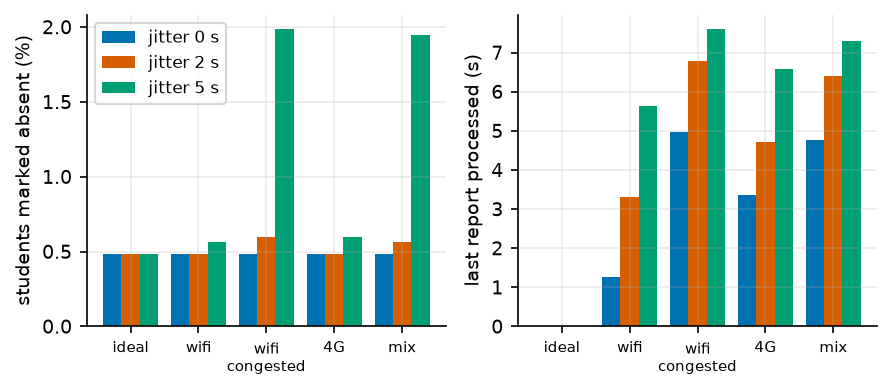

## E07 BLE contention

*Do advertising collisions matter at 93 phones, and does the fast model agree with the packet-level one?*

| students | adv (ms) | model | false-absent | PDUs lost to collisions % |
|---|---|---|---|---|
| 10 | 100.0 | fast | 60.53% [40.88, 77.71] | - |
| 10 | 100.0 | des | 63.16% [44.02, 80.27] | 1.3 |
| 10 | 100.0 | des+capture | 63.16% [44.02, 80.27] | 1.4 |
| 10 | 200.0 | fast | 59.21% [39.74, 77.02] | - |
| 10 | 200.0 | des | 64.47% [45.33, 81.65] | 0.8 |
| 10 | 200.0 | des+capture | 64.47% [45.33, 81.65] | 0.9 |
| 10 | 300.0 | fast | 59.21% [39.74, 77.02] | - |
| 10 | 300.0 | des | 59.21% [40.79, 76.36] | 0.5 |
| 10 | 300.0 | des+capture | 57.89% [39.12, 74.84] | 0.5 |
| 30 | 100.0 | fast | 2.16% [1.07, 3.40] | - |
| 30 | 100.0 | des | 4.32% [2.51, 6.30] | 3.5 |
| 30 | 100.0 | des+capture | 3.78% [1.98, 5.78] | 3.4 |
| 30 | 200.0 | fast | 2.16% [1.07, 3.40] | - |
| 30 | 200.0 | des | 5.04% [3.09, 7.09] | 1.9 |
| 30 | 200.0 | des+capture | 4.32% [2.53, 6.19] | 1.9 |
| 30 | 300.0 | fast | 2.16% [1.07, 3.40] | - |
| 30 | 300.0 | des | 4.86% [2.87, 7.07] | 1.4 |
| 30 | 300.0 | des+capture | 4.86% [2.87, 7.19] | 1.4 |
| 60 | 100.0 | fast | 0.79% [0.44, 1.15] | - |
| 60 | 100.0 | des | 0.79% [0.35, 1.23] | 6.3 |
| 60 | 100.0 | des+capture | 0.79% [0.35, 1.23] | 6.1 |
| 60 | 200.0 | fast | 0.79% [0.44, 1.15] | - |
| 60 | 200.0 | des | 0.79% [0.35, 1.23] | 3.6 |
| 60 | 200.0 | des+capture | 0.79% [0.35, 1.23] | 3.5 |
| 60 | 300.0 | fast | 0.70% [0.35, 1.06] | - |
| 60 | 300.0 | des | 0.70% [0.26, 1.15] | 2.5 |
| 60 | 300.0 | des+capture | 0.70% [0.26, 1.15] | 2.4 |
| 93 | 100.0 | fast | 0.28% [0.11, 0.51] | - |
| 93 | 100.0 | des | 0.28% [0.11, 0.51] | 9.0 |
| 93 | 100.0 | des+capture | 0.28% [0.11, 0.51] | 8.7 |
| 93 | 200.0 | fast | 0.28% [0.11, 0.51] | - |
| 93 | 200.0 | des | 0.28% [0.11, 0.51] | 5.3 |
| 93 | 200.0 | des+capture | 0.28% [0.11, 0.51] | 5.2 |
| 93 | 300.0 | fast | 0.28% [0.11, 0.51] | - |
| 93 | 300.0 | des | 0.28% [0.11, 0.51] | 3.7 |
| 93 | 300.0 | des+capture | 0.28% [0.11, 0.51] | 3.6 |

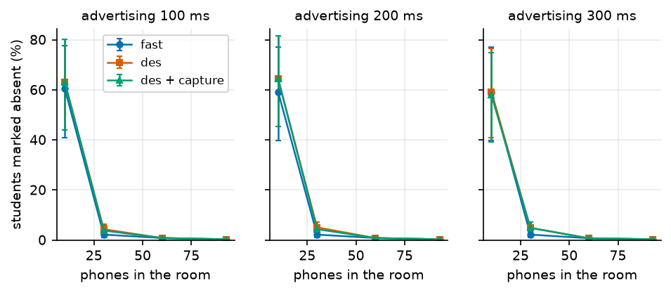

## E08 Robustness to assumptions

*Which assumed value would hurt most if reality differs?*

| parameter | side | value | false-absent | corridor admitted |
|---|---|---|---|---|
| baseline | - | - | 0.36% [0.17, 0.59] | 0.00% [0.00, 0.00] |
| n | low | 2.4 | 0.36% [0.17, 0.59] | 10.94% [3.44, 19.38] |
| n | high | 3.6 | 0.36% [0.17, 0.59] | 0.00% [0.00, 0.00] |
| shadow_sigma | low | 3.0 | 0.42% [0.20, 0.67] | 0.00% [0.00, 0.00] |
| shadow_sigma | high | 8.0 | 0.36% [0.17, 0.59] | 18.75% [9.68, 29.06] |
| fast_sigma | low | 2.0 | 0.36% [0.17, 0.59] | 0.00% [0.00, 0.00] |
| fast_sigma | high | 6.0 | 0.36% [0.17, 0.59] | 0.00% [0.00, 0.00] |
| dir_sigma | low | 0.0 | 0.36% [0.17, 0.59] | 0.31% [0.00, 0.94] |
| dir_sigma | high | 3.0 | 0.51% [0.25, 0.79] | 0.00% [0.00, 0.00] |
| body_db | low | 1.0 | 0.36% [0.17, 0.59] | 1.56% [0.00, 4.06] |
| body_db | high | 5.0 | 0.36% [0.17, 0.59] | 0.00% [0.00, 0.00] |
| wall_db | low | 6.0 | 0.36% [0.17, 0.59] | 7.50% [2.19, 14.37] |
| wall_db | high | 18.0 | 0.36% [0.17, 0.59] | 0.00% [0.00, 0.00] |
| p_detect | low | 0.9 | 0.51% [0.25, 0.81] | 0.00% [0.00, 0.00] |
| p_detect | high | 1.0 | 0.36% [0.17, 0.59] | 0.00% [0.00, 0.00] |
| tap_median_s | low | 2.0 | 0.00% [0.00, 0.00] | 0.00% [0.00, 0.00] |
| tap_median_s | high | 8.0 | 6.12% [5.28, 7.05] | 0.00% [0.00, 0.00] |
| seat_pitch | low | 0.4 | 0.36% [0.17, 0.59] | 0.62% [0.00, 1.88] |
| seat_pitch | high | 0.7 | 0.39% [0.17, 0.67] | 0.00% [0.00, 0.00] |
| A | low | -65.0 | 4.60% [3.40, 5.92] | 0.00% [0.00, 0.00] |
| A | high | -53.0 | 0.36% [0.17, 0.59] | 40.00% [26.88, 54.38] |

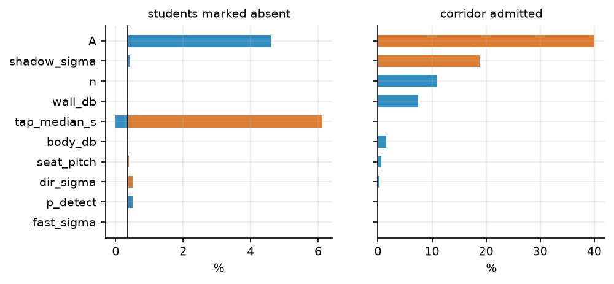

## E09 Baselines

*How does NetPresence compare with the alternatives a teacher could use today?*

| door | method | false-absent | corridor admitted | proxy succeeds | time (s) |
|---|---|---|---|---|---|
| closed | B0 manual roll call | 0.00% [0.00, 0.00] | 0.00% [0.00, 0.00] | 52.33% [47.00, 57.67] | 264 |
| closed | B1 teacher beacon | 30.04% [28.73, 31.36] | 6.88% [4.58, 9.38] | 30.00% [25.33, 35.00] | 20 |
| closed | B2 acoustic (v1) | 32.83% [31.51, 34.27] | 0.00% [0.00, 0.00] | 30.00% [25.33, 35.00] | 20 |
| closed | B3 no disjoint paths | 0.41% [0.22, 0.62] | 0.00% [0.00, 0.00] | 1.67% [0.33, 3.67] | 26 |
| closed | B4 no self-calibration | 0.75% [0.49, 1.03] | 0.00% [0.00, 0.00] | 1.67% [0.33, 3.67] | 26 |
| closed | B5 rotating QR | 3.33% [2.86, 3.86] | 0.00% [0.00, 0.00] | 30.33% [25.33, 35.33] | 20 |
| closed | NetPresence | 0.41% [0.22, 0.62] | 0.00% [0.00, 0.00] | 1.67% [0.33, 3.67] | 26 |
| closed | NetPresence, no co-location | 0.41% [0.22, 0.62] | 0.00% [0.00, 0.00] | 100.00% [100.00, 100.00] | 26 |
| open | B0 manual roll call | 0.00% [0.00, 0.00] | 0.00% [0.00, 0.00] | 52.33% [47.00, 57.67] | 264 |
| open | B1 teacher beacon | 30.04% [28.73, 31.36] | 6.88% [4.58, 9.38] | 30.00% [25.33, 35.00] | 20 |
| open | B2 acoustic (v1) | 32.83% [31.51, 34.27] | 0.00% [0.00, 0.00] | 30.00% [25.33, 35.00] | 20 |
| open | B3 no disjoint paths | 0.41% [0.22, 0.62] | 5.62% [1.88, 10.42] | 1.67% [0.33, 3.67] | 26 |
| open | B4 no self-calibration | 0.75% [0.49, 1.03] | 0.00% [0.00, 0.00] | 1.67% [0.33, 3.67] | 26 |
| open | B5 rotating QR | 3.33% [2.86, 3.86] | 0.00% [0.00, 0.00] | 30.33% [25.33, 35.33] | 20 |
| open | NetPresence | 0.41% [0.22, 0.62] | 0.00% [0.00, 0.00] | 1.67% [0.33, 3.67] | 26 |
| open | NetPresence, no co-location | 0.41% [0.22, 0.62] | 0.00% [0.00, 0.00] | 100.00% [100.00, 100.00] | 26 |

All baseline parameters are `assumed` (see netsim/baselines.py); 30% iPhones.

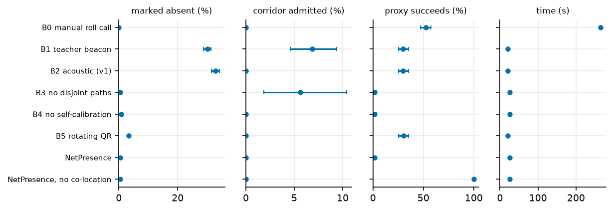

## E10 Who gets missed

*Do the back benches get missed, and does the multi-hop flood fix that?*

| method | front half absent % | back half absent % |
|---|---|---|
| B2 acoustic (v1) | 22.5 | 42.3 |
| B1 teacher beacon | 14.3 | 44.5 |
| NetPresence | 0.4 | 0.5 |

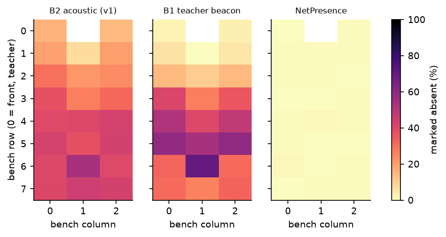

## E11 Scalability

*Does the system still work in a 200- or 500-seat hall, and what does it cost to compute?*

| students | bench rows | false-absent (ttl 8, 15 m) | false-absent (ttl 12, 25 m) | max hops | max path (m) |
|---|---|---|---|---|---|
| 50 | 5 | 0.36% [0.00, 0.90] | 0.36% [0.00, 0.90] | 4 | 5.8 |
| 100 | 9 | 0.43% [0.17, 0.69] | 0.43% [0.17, 0.69] | 6 | 8.4 |
| 200 | 17 | 12.19% [8.70, 15.24] | 0.25% [0.08, 0.47] | 8 | 13.1 |
| 300 | 25 | 38.88% [37.08, 41.22] | 9.07% [6.95, 11.37] | 8 | 13.8 |
| 500 | 42 | 65.81% [64.57, 67.05] | 46.71% [44.44, 48.91] | 8 | 13.2 |

Default TTL is 8 hops / 15 m (dashed line).

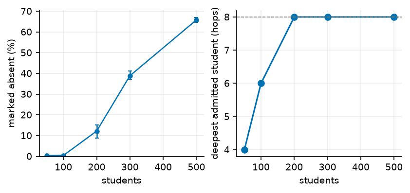

## E12 Simulator vs real phones

*Does the simulator predict what real phones do?*

**NO REAL DATA: simulator prediction only**

| preset | real sessions | simulated false-absent | real false-absent | simulated corridor | real corridor |
|---|---|---|---|---|---|
| lab6 | 0 | 0.33% [0.00, 1.03] | n/a | 0.00% [0.00, 0.00] | n/a |

## E13 Trace-driven channel

*Do empirical RSSI tables from the BLE lab change the conclusions?*

Trace source: **SYNTHETIC (drawn from the parametric model; not measured)**

| students | door | channel | false-absent | corridor admitted |
|---|---|---|---|---|
| 35 | closed | parametric | 0.84% [0.31, 1.44] | 3.44% [0.00, 9.69] |
| 35 | closed | trace | 0.69% [0.23, 1.29] | 0.00% [0.00, 0.00] |
| 35 | open | parametric | 0.99% [0.45, 1.62] | 9.38% [2.50, 18.76] |
| 35 | open | trace | 0.69% [0.23, 1.29] | 3.75% [0.31, 9.38] |
| 93 | closed | parametric | 0.36% [0.17, 0.59] | 0.00% [0.00, 0.00] |
| 93 | closed | trace | 0.56% [0.28, 0.87] | 0.00% [0.00, 0.00] |
| 93 | open | parametric | 0.36% [0.17, 0.59] | 0.00% [0.00, 0.00] |
| 93 | open | trace | 0.56% [0.28, 0.87] | 0.00% [0.00, 0.00] |

## E14 Energy

*What does one roll call cost a student's battery?*

All currents are ASSUMED (no power measurement yet).

| method | mAh per roll call | % of 4000 mAh per day (6 lectures) |
|---|---|---|
| NetPresence | 1.0451 | 0.157 |
| acoustic v1 (student phone) | 0.9167 | 0.138 |
| rotating QR (student phone) | 0.4444 | 0.067 |

